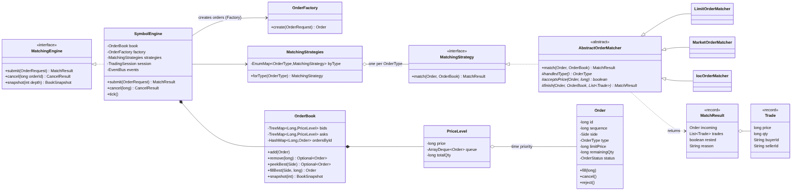

# DalalX — The Morning Edition

A multi-stock exchange simulator with a real order-matching engine, built for an Object-Oriented Modelling course. Five simulated stocks trade live, each matched on its own thread. Trading bots make the market, storylines bend it, a circuit breaker and call auction protect it, and a surveillance desk catches the bot that cheats. The UI is a financial newspaper with Day and Night editions.



## Run

Requirements: Java 21+, Maven 3.9+, Node 20+.

```bash
(cd frontend && npm install)   # first time only
./run.sh                       # backend :8080 + frontend :5173 — Ctrl+C stops both
```

Open http://localhost:5173 (the front page). For the guided tour, run `./demo.sh`, or open http://localhost:5173/#/demo once it's running.

## Test and benchmark

```bash
mvn -q verify                                  # ~310 Java tests (core + server)
(cd frontend && npm test && npm run build)     # 49 frontend tests + type check
./bench.sh                                     # matching benchmark (docs/BENCHMARK.md)
```

## What's inside

| Module | What it is |
|---|---|
| `core/` | Pure Java 21, no framework: model, order book, matching, exchange, events, market data, bots, storylines, circuit breaker, call auction, X-Ray, surveillance, headlines |
| `server/` | Spring Boot 3, *adapters only*: REST (`/api/...`) and STOMP WebSocket (`/ws`, `/topic/...`) |
| `frontend/` | React + Vite + TypeScript: Front Page, Trading Floor, X-Ray, Correspondents, Investigations, demo autopilot |
| `design/` | The UI design export (read-only) |
| `docs/` | Notes, UML, guides |

### Features

- **Matching:** LIMIT, MARKET and IOC orders with price-time priority; cancels.
- **Concurrency:** one worker thread per stock, with a `BlockingQueue` hand-off (thread confinement, no locks in the book).
- **Live market data:** candles (1m/5m/15m/1D), the tape and the book, pushed over WebSocket every 100 ms.
- **Bots:** The Munim (market maker), Momentum Chaser, Panic Seller, The Whale and The Spoofer. You can hire more and tune them.
- **Storylines:** Flash Crash, Bubble, Whale Dump, Calm Market.
- **Circuit breaker:** a 10% move in 60 s halts trading for 30 s (State pattern).
- **Call auction:** the stock reopens at the single price that trades the most shares.
- **X-Ray:** a step-by-step replay of how your order was matched.
- **Market surveillance:** spoofing, layering, wash-trade and pump detection, with evidence timelines and suspensions.
- **The Wire:** live newspaper headlines.
- **Demo autopilot:** a 13-step guided tour of about 3 minutes (`./demo.sh` or `#/demo`).

### Design patterns

Strategy · Template Method · Factory · Observer · State · Adapter · Memento · Null Object · Command, plus Open/Closed and Dependency Inversion. See `docs/UML.md`.

## Documentation

| File | For |
|---|---|
| `docs/LEARNING_GUIDE.md` | The order to read the code in, and what each part teaches |
| `docs/UML.md` | Class, state, sequence and module diagrams |
| `docs/VIVA.md` | Likely questions and answers |
| `docs/DEMO_SCRIPT.md` | An 8-minute demo |
| `docs/NOTES.md` | Build log: what each step added, with viva points |
| `docs/BENCHMARK.md` | Performance numbers and how to measure them |
| `CLAUDE.md` | Project rules |
