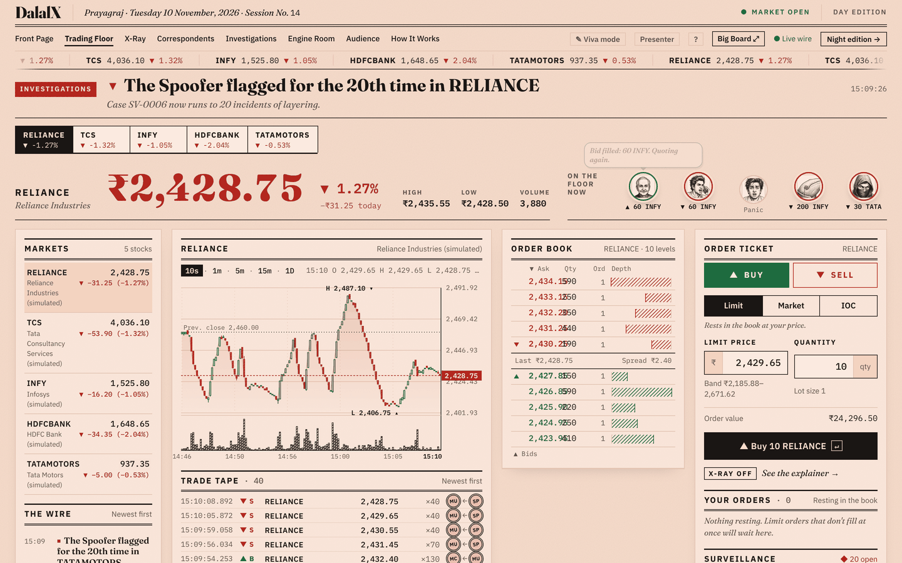
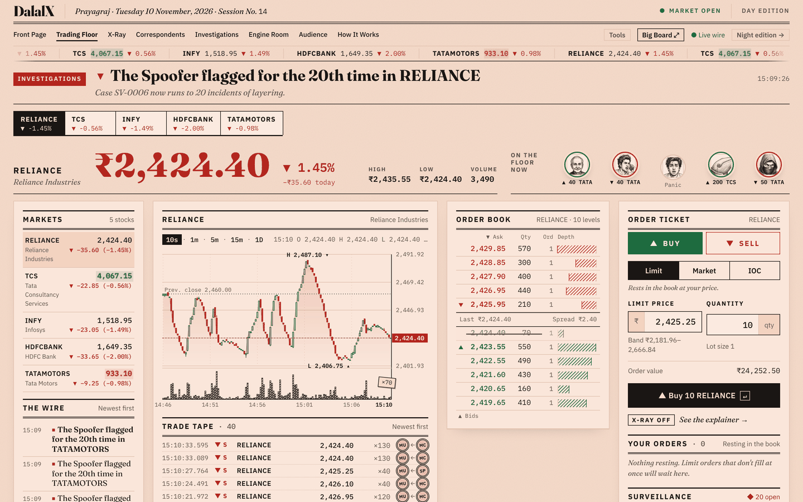
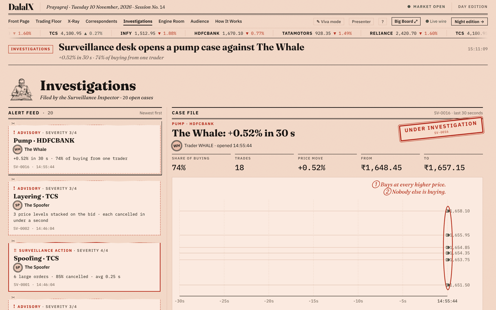
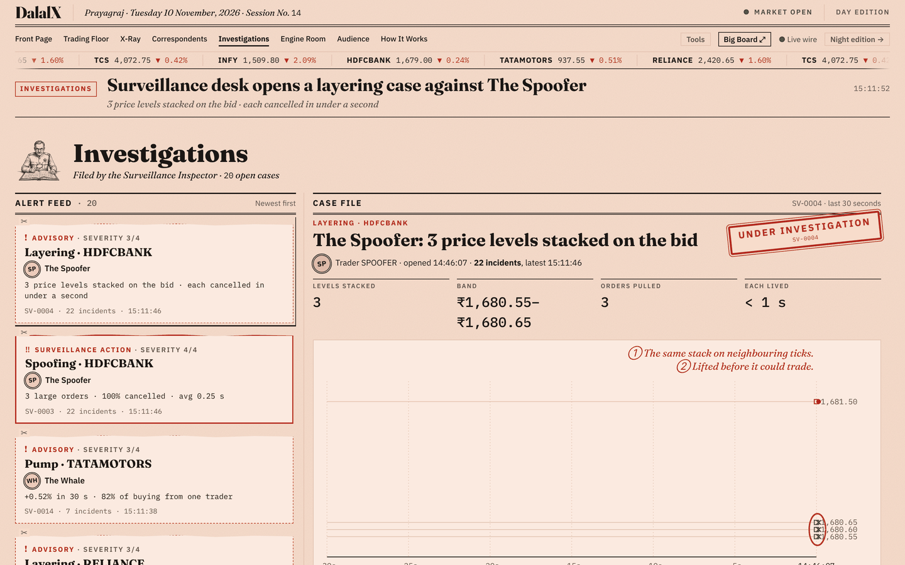
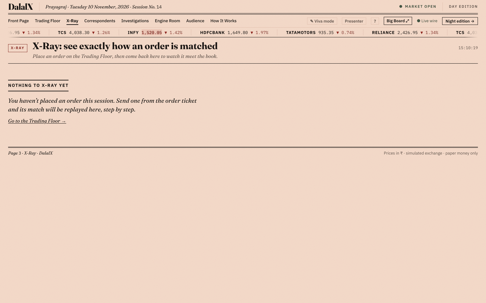
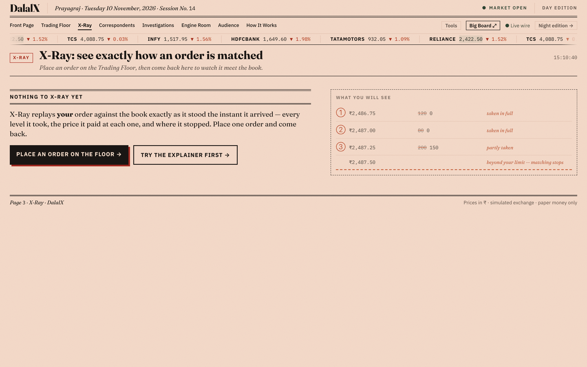
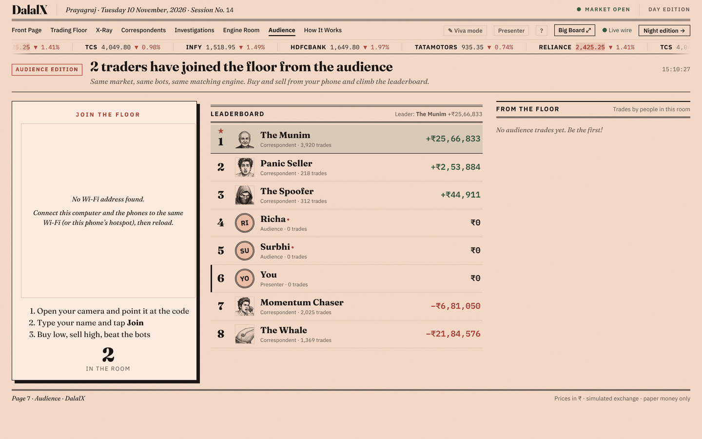
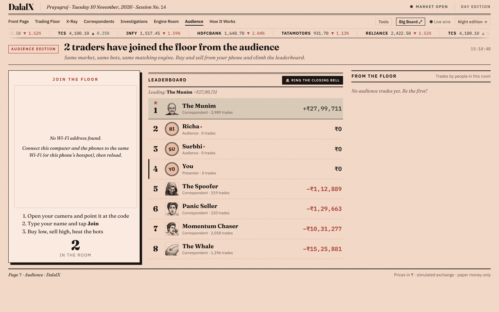

# Before and after — what the design pass changed

Four screens, photographed at the same width (1440px) before and after Steps 19
and 20. Useful in the viva when someone asks *what you changed and why*: each
pair has a reason underneath it, not just a look.

The "before" shots come from commit `feb8921`, the "after" from `9a20758`.

---

## The Trading Floor

| Before | After |
|---|---|
|  |  |

- **Sizes came from a system, not from each panel.** 28 different font sizes
  and 18 different gaps were replaced by 14 named type tokens and 7 spacing
  steps, all in `src/design/scale.css`. About 470 hand-written values went; no
  `.tsx` file sets a raw `fontSize` any more.
- **The order book holds its digits.** Price and quantity now keep a minimum
  width and the depth bar is the only column allowed to give width back. Below
  about 1500px the price and quantity used to overlap.
- **Matching is visible end to end.** When trades eat a whole price level, a
  chit carrying that size flies from the book to the trade tape, where the
  trade prints a moment later.

## Investigations

| Before | After |
|---|---|
|  |  |

- **One investigation per offender, not per offence.** Each finding used to
  open its own case — 151 of them in a long session, each with its own
  headline on the Wire. A repeat now folds into the case already open and
  bumps an incident count ("22 incidents, latest 15:11:46"), which is how a
  real surveillance desk files them. The Wire prints the first and then every
  tenth.

## X-Ray

| Before | After |
|---|---|
|  |  |

- **The empty state teaches instead of apologising.** It now shows what a
  matched order will look like, so the page explains itself before you have
  placed anything.
- **Rows have room.** Wider columns and taller rows; the explanation column
  stays put while the steps scroll.

## Audience

| Before | After |
|---|---|
|  |  |

- **The leaderboard moves like a leaderboard.** A row that climbs starts where
  it used to be and slides to its new place, instead of jumping.
- **A round can end.** The presenter rings the closing bell and the paper
  prints a Final Edition: the top three on a podium, and whether the room beat
  the machines.

## Everywhere

- **One Tools menu** in place of four separate buttons in the section bar
  (Viva · Presenter · Sound · Shortcuts), each with its keyboard shortcut
  printed beside it.
- **Every control answers.** Hover, press, disabled, busy and focus are stated
  once in `src/ui/ui.css`, as a wash laid *over* whatever colour a control
  already has — so the green Buy button deepens rather than being repainted.
- **Shared parts.** `Stat`, `Tag`, `Card`, `DataTable`, `Empty` and `Loading`
  in `src/ui/` mean a figure or a table looks the same wherever it appears.
