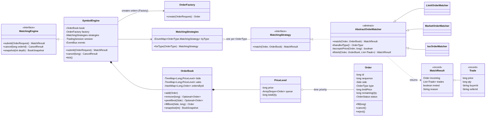
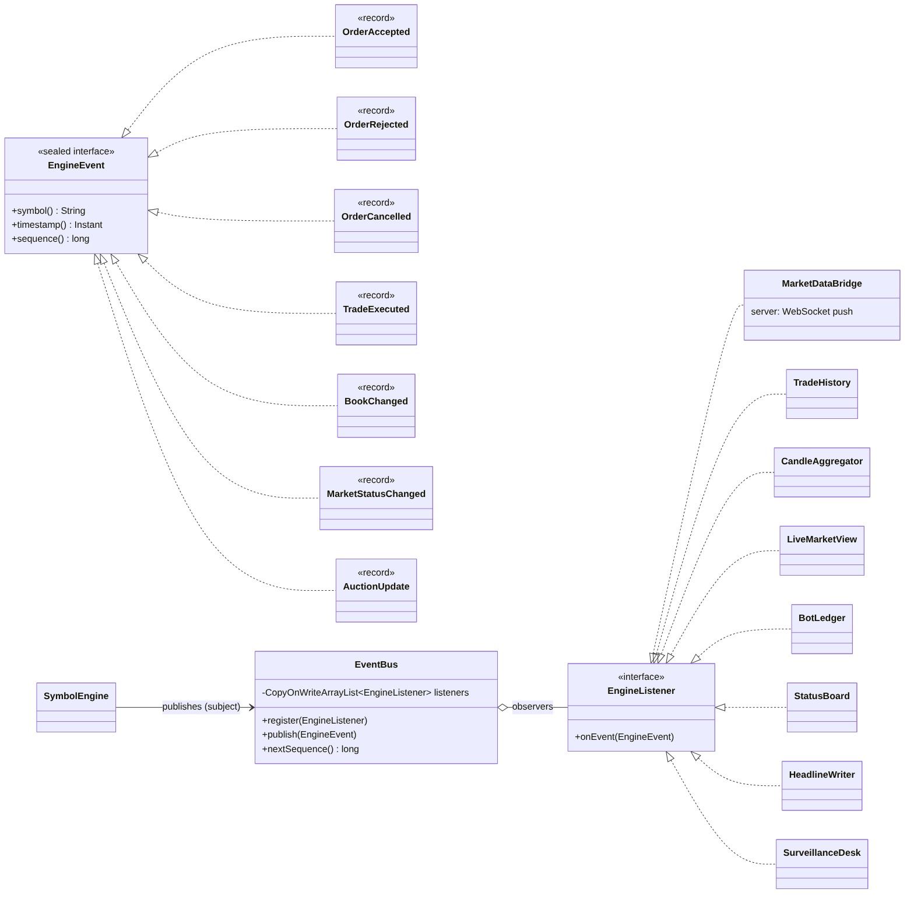
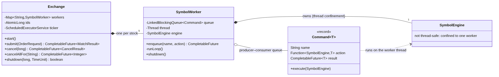
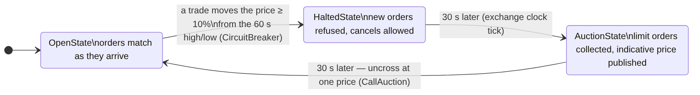
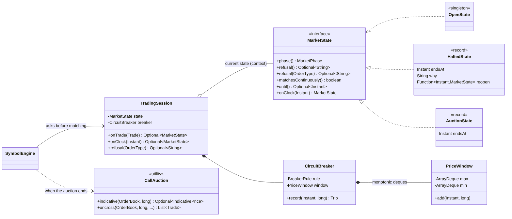
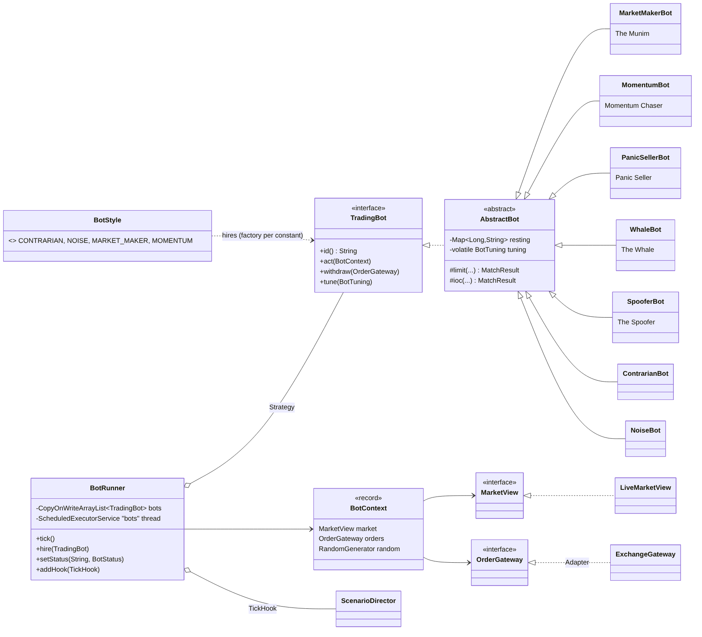
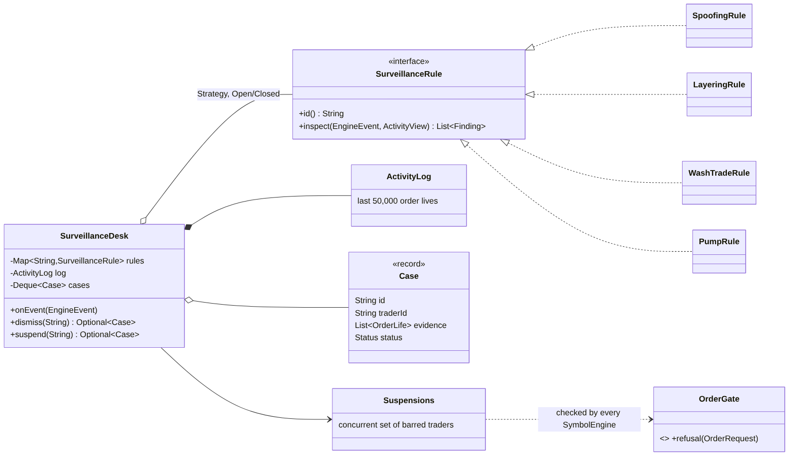
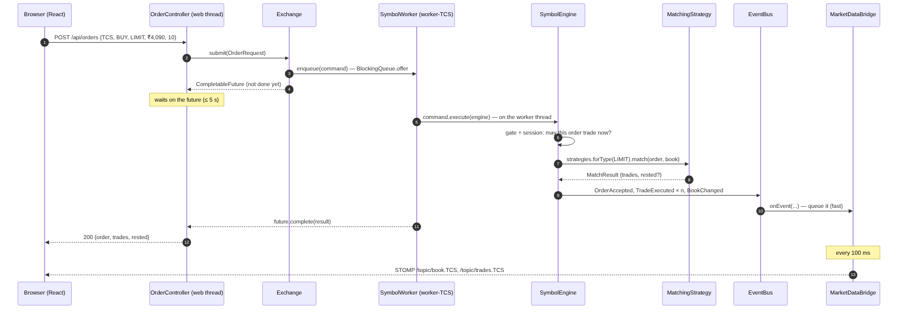
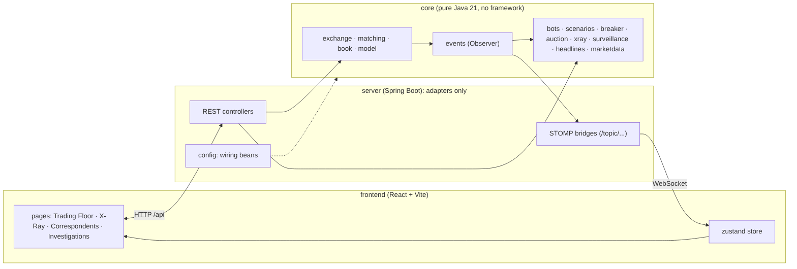

# DalalX: UML diagrams

Every diagram is drawn from the real code. The editable source is the `.mmd` file next to each picture in `docs/uml/` (Mermaid; GitHub renders it). To redraw the PNGs after a change: `npx -p @mermaid-js/mermaid-cli mmdc -i docs/uml/01-matching.mmd -o docs/uml/01-matching.png -s 2 -b white`.

**How to read the arrows**

| Arrow | Means | Example |
|---|---|---|
| `<\|..` dashed, hollow triangle | implements an interface | `SymbolEngine` implements `MatchingEngine` |
| `<\|--` solid, hollow triangle | extends a class | `LimitOrderMatcher` extends `AbstractOrderMatcher` |
| `*--` filled diamond | composition: the part lives and dies with the whole | an `OrderBook` owns its `PriceLevel`s |
| `o--` hollow diamond | aggregation: holds parts that exist on their own | `EventBus` holds listeners |
| `-->` | association: uses / knows about | `SymbolEngine` uses `OrderFactory` |
| `..>` | dependency: briefly uses | a matcher returns a `MatchResult` |

---

## 1. Matching core: Strategy, Template Method, Factory

- **Strategy:** `MatchingStrategy` has one implementation per order type, and `MatchingStrategies` maps each `OrderType` to its matcher in an `EnumMap`. `SymbolEngine` never has a `switch` on order type.
- **Template Method:** `AbstractOrderMatcher.match()` is the one shared loop (`final`). The three subclasses fill in the hooks `handledType()`, `acceptsPrice()` and `finish()`.
- **Factory:** only `OrderFactory` creates `Order`s, so ids, sequence numbers and timestamps are always assigned correctly.
- **Data structures:** `OrderBook` has a `TreeMap` of price levels per side (bids in reverse order, so the best is always first) and a `HashMap` from id to order for O(1) cancels. Each `PriceLevel` keeps an `ArrayDeque` in time order.

## 2. Events: Observer

`SymbolEngine` is the **subject**. It publishes to the `EventBus`, which calls every registered `EngineListener` (the **observers**). Eight features listen without the engine knowing about any of them. `EngineEvent` is a `sealed` interface, so a `switch` over events must handle all seven kinds (the compiler checks it).

## 3. Concurrency: one thread per stock

`Exchange` owns five `SymbolWorker`s. Each worker owns one `SymbolEngine` and is the **only** thread that touches it (thread confinement). Everyone else sends a `Command` through the worker's `BlockingQueue` (producer–consumer) and gets a `CompletableFuture` back.

## 4. Trading phases: State

Each phase is a class implementing `MarketState`. `TradingSession` is the **context**: it holds the current state and swaps it on a transition. `CircuitBreaker` keeps the last 60 seconds' high and low in two monotonic deques (`PriceWindow`). `CallAuction` finds the single price that trades the most shares when an auction ends.

## 5. Bots: Strategy, Adapter, Factory

Every bot is a `TradingBot` and `BotRunner` only calls `act()`. Bots see the market only through `MarketView` and trade only through `OrderGateway`; the real `ExchangeGateway` is an **Adapter** from the exchange's asynchronous API to a simple blocking one. `BotStyle` is an enum where each constant builds its own bot class (a factory per constant). Storylines (`ScenarioDirector`) run on the same bot thread as a tick hook.

## 6. Market surveillance: Strategy + Open/Closed

Each abuse pattern is a `SurveillanceRule` with its own sliding-window state; adding one is a new class. The desk keeps an `ActivityLog` of recent order lives to attach as evidence. A suspension adds the trader to `Suspensions`, which every engine consults through the `OrderGate` interface.

## 7. Placing an order, end to end

The web thread never touches the book: it waits on a future while the stock's worker thread does the matching. The browser gets its own reply from REST at once; everyone else hears about it through the WebSocket within 100 ms.

## 8. Modules

`core` has no framework at all. `server` only adapts it to HTTP and WebSocket (Ports & Adapters). `frontend` talks to `server` only.
