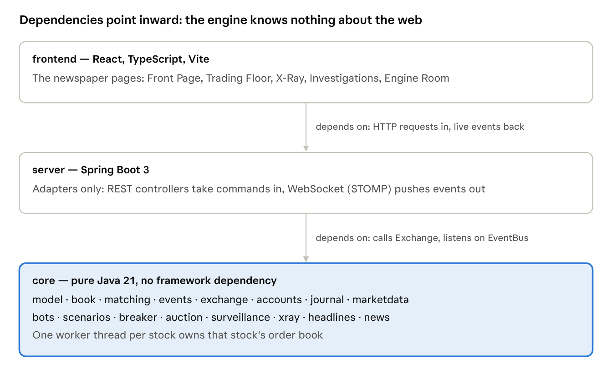
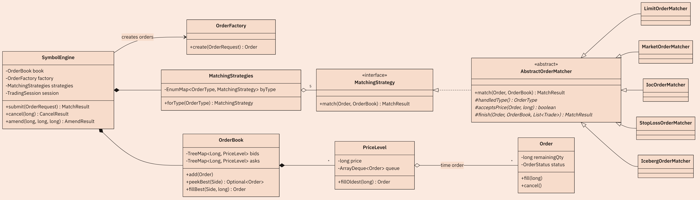
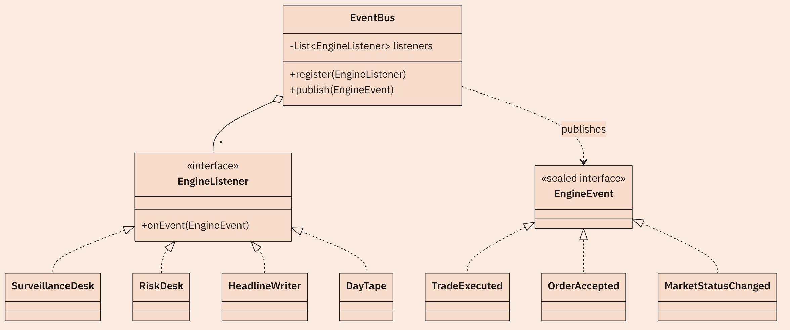
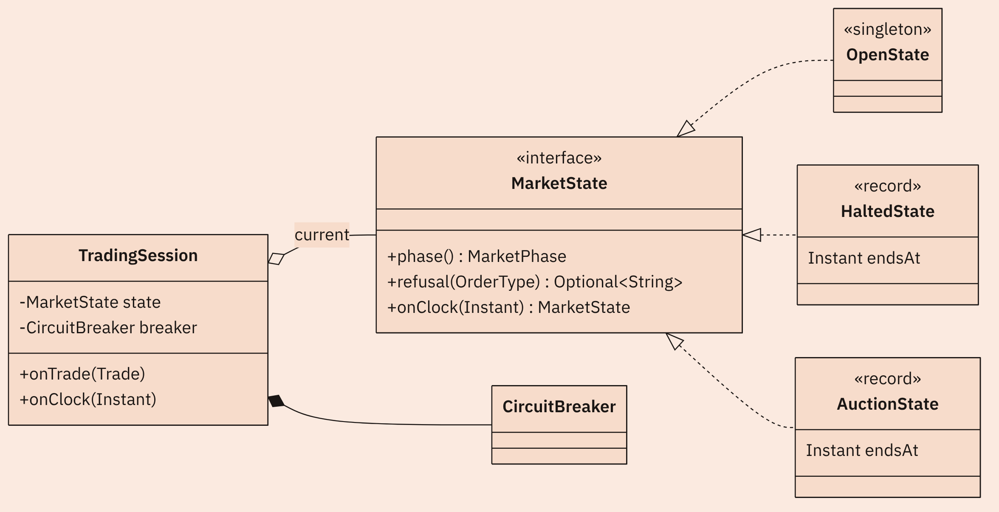
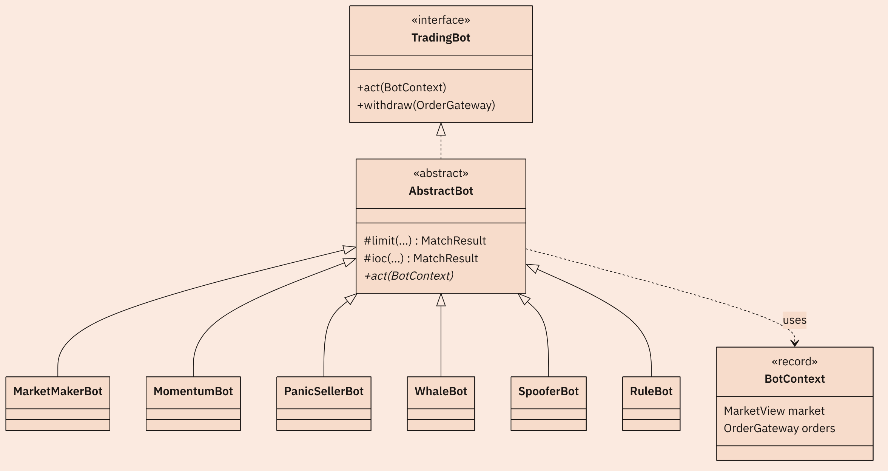
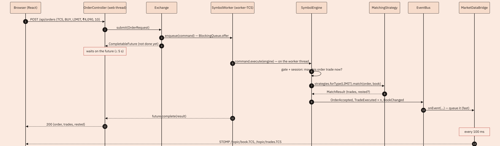
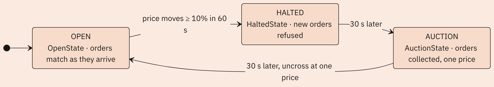

## 1. Introduction

The project builds a working stock exchange from scratch and uses it to show object-oriented modelling in practice: every feature is a class that plugs into an interface, and the engine rarely changes when a feature is added.

**Problem.** An exchange receives buy and sell orders from many people at once and must decide, fairly and quickly, which buyer trades with which seller and at what price. It must also stop runaway prices, catch manipulation, and never lose an order.

**Objectives.**

1. Build a pure-Java matching engine that follows price-time priority, with money held exactly in paise.
2. Design it with clear OOP: named design patterns, SOLID principles, and code a student can read and defend.
3. Run several stocks in parallel safely, without locks inside the order book.
4. Add the systems a real market needs: circuit breaker, call auction, surveillance, accounts with risk checks, and crash recovery.
5. Make the engine visible through a web interface, so a viewer can watch an order being matched.

**Scope.** Five simulated stocks (RELIANCE, TCS, INFY, HDFCBANK, TATAMOTORS; up to 12 listed at runtime), simulated prices and news, pretend money. It is a teaching system, not connected to any real market.

## 2. Background: how an exchange matches orders

An exchange keeps one **order book** per stock: buyers' bids sorted from highest price down, sellers' asks sorted from lowest price up. While the best bid is below the best ask, nothing trades; the gap is the **spread**.

When a new order arrives, the engine applies three rules:

1. **Best price first.** A bid at ₹102.50 is filled before a bid at ₹102.40.
2. **Then earliest first.** At the same price, the order that arrived first is filled first.
3. **The resting order sets the price.** A trade happens at the price of the order that was already waiting.

This is **price-time priority**, the rule used by NSE, BSE and NYSE. An order that is only partly filled leaves its remainder resting in the book (a **partial fill**).

| Order type | Behaviour |
| --- | --- |
| Limit | Trades at its price or better; the rest waits in the book |
| Market | Trades immediately at the best available prices; never waits |
| IOC (Immediate or Cancel) | Trades what it can now at its price; the rest is cancelled |
| Stop-loss | Hidden until the last price reaches its trigger, then trades as a market order |
| Iceberg | Shows one slice at a time; each new slice joins the back of the queue |

## 3. Requirements

**Functional**

| ID | Requirement |
| --- | --- |
| F1 | Accept limit, market, IOC, stop-loss and iceberg orders; cancel and amend resting orders |
| F2 | Match by price-time priority and publish every trade and book change |
| F3 | Halt a stock that moves 10% within 60 seconds, then reopen it through a call auction |
| F4 | Run trading bots with different behaviours, including user-built rule bots and a timed tournament |
| F5 | Detect spoofing, layering, wash trades, pumping and front-running, and open cases with evidence |
| F6 | Hold accounts (name and PIN) with ₹10,00,000 starting cash; refuse orders beyond free cash or owned shares |
| F7 | Journal every command and rebuild the market after a restart; replay a past session (Rewind) |
| F8 | Show the market live in a browser, and let an audience trade from phones |

**Non-functional**

| ID | Requirement |
| --- | --- |
| N1 | Money is a `long` in paise; `double` is never used for prices |
| N2 | The core engine has no framework dependency (no Spring) |
| N3 | Each order book is touched by exactly one thread; no locks inside the book |
| N4 | New order types, rules and bots are added without editing existing classes (Open/Closed) |
| N5 | Every class carries a Javadoc paragraph naming its purpose and pattern |
| N6 | Every feature is covered by JUnit 5 tests before it is accepted |

## 4. System architecture

The system is a Maven multi-module project with three modules, and every dependency points inward towards the engine.

*Figure 1. Module structure: three Maven modules.*

The `core` module contains all business logic in 16 packages and has no Spring import anywhere, so it builds and tests in seconds without a server. The `server` module only adapts the core to the web, and the `frontend` only draws what the engine has already decided. The web layer could be replaced by a desktop UI without changing a line of the engine (Dependency Inversion).

## 5. Object model

The class diagrams below are drawn from the real classes; every name on them exists in the code.

### 5.1 Matching

`SymbolEngine` owns one `OrderBook` and a `MatchingStrategies` registry (composition). The registry holds one `MatchingStrategy` per order type. `AbstractOrderMatcher` implements the shared matching loop once (Template Method), and its five subclasses supply only what differs. The book keeps bids and asks as sorted maps of `PriceLevel`s, each a first-in, first-out queue of `Order`s: price ordering comes from the map, time ordering from the queue.

*Figure 2. Class diagram: matching.*

### 5.2 Events and market state

The `EventBus` publishes every `EngineEvent` to any number of `EngineListener`s (Observer); surveillance, the risk desk, headlines and the day's tape are all listeners. `TradingSession` holds one `MarketState` (State): Open, Halted or Auction, each deciding what an order may do.

*Figure 3. Class diagram: Observer (events).*

*Figure 4. Class diagram: State (market status).*

### 5.3 Bots

Every bot implements `TradingBot`; most extend `AbstractBot`, which holds the shared code for placing and withdrawing orders. A bot sees the market only through a `BotContext` holding a `MarketView` and an `OrderGateway`, two narrow interfaces.

*Figure 5. Class diagram: bots.*

## 6. OOP principles and design patterns

Each principle and pattern below exists in the code and is named in the Javadoc of the class that uses it.

| Principle or pattern | Where it lives | What it achieves |
| --- | --- | --- |
| Encapsulation | `Order.fill`, `OrderBook`, `Account` | Objects enforce their own rules: an order cannot be overfilled or grown in place; an account cannot spend the same rupee twice |
| Abstraction | `MarketView`, `OrderGateway`, `MatchingStrategy` | Callers depend on what an object does, not how; bots never see the `Exchange` |
| Inheritance | `AbstractOrderMatcher`, `AbstractBot` | Shared code written once; five matchers and eight bots supply only what differs |
| Polymorphism | `strategies.forType(type).match(order, book)` | One call runs five behaviours with no if-chain |
| Single Responsibility | `StopBook` and `StopLossOrderMatcher` | One class decides when a stop fires, another how it trades |
| Open/Closed | `MatchingStrategies.standard` | Stop-loss and iceberg added as two classes and two lines; no matcher edited |
| Liskov Substitution | any matcher, bot or market state | Any child works wherever its parent type is expected |
| Interface Segregation | `MarketView` + `OrderGateway` | Bots get two small interfaces instead of the whole exchange |
| Dependency Inversion | no Spring in `core`; injected `Clock` | The web is a detail plugged in from outside; time can be replayed |
| Strategy | matchers, bots, order gates | Swap behaviour at run time |
| Template Method | `AbstractOrderMatcher.match` | A `final` algorithm with abstract hooks |
| Factory | `OrderFactory` | Every order is created valid, with id, sequence and timestamp |
| Observer | `EventBus`, `EngineListener` | The engine announces events; surveillance, risk, charts and headlines listen |
| State | `MarketState`: Open, Halted, Auction | Market status as objects, so no code asks "are we halted?" |
| Command | `Command`, the journal | Requests become objects that are queued, logged and replayed |
| Memento | X-Ray snapshots | The book's state at each matching step, kept for replay |
| Singleton, Null Object, Composite | `OpenState.INSTANCE`, `OrderGate.OPEN`, `OrderGate.allOf` | One stateless instance; a do-nothing gate instead of null; many gates acting as one |
| Adapter, Facade | `ExchangeGateway`, Spring controllers; `Exchange` | Translate one interface to another; one front door to the subsystem |

Value objects such as `Trade`, `OrderRequest` and every event are immutable Java `record`s, so they are safe to share between threads. `EngineEvent` is a `sealed` interface, so the compiler knows every kind of event.

## 7. Concurrency design

Each stock has exactly one worker thread (`SymbolWorker`), and that thread is the only code that ever touches its order book. This is **thread confinement**: the book is deliberately not thread-safe, because it never needs to be.

- **Producer–consumer.** Web requests, bots and audience phones put `Command` objects on the worker's `BlockingQueue`; the worker takes them one at a time, in arrival order.
- **Results.** The caller receives a `CompletableFuture` that the worker completes once the order is matched.
- **Back-pressure.** When a queue is full, a sender waits up to one second instead of overloading memory.
- **No locks between stocks.** An order is always for one stock, so five stocks run in parallel with no shared state in the books. Objects that cross threads are immutable records.

The sequence diagram below follows one order from the browser to the trade tape.

*Figure 6. Sequence diagram: placing one order.*

## 8. Features

**Order types and amend.** Five order types share one matching loop. Reducing an order's quantity at the same price keeps its queue position; a new price or a larger quantity is a cancel and re-entry at the back.

**Circuit breaker and call auction.** A move of 10% within 60 seconds halts the stock for 30 seconds. A 30-second call auction then collects orders and reopens at the one price that trades the most shares, so arriving first stops mattering at the reopen.

*Figure 7. State diagram: the circuit breaker.*

**Bots.** A market maker (Munim), Momentum, Panic Seller, Whale, Contrarian, Noise and a Spoofer keep the market alive. Users build their own rule bots from a form ("buy 100 INFY whenever it falls 0.3%") and run timed tournaments. Simulated company news every 60–150 seconds moves the bots' idea of fair value.

**Surveillance.** Five rules read the same event stream as the charts: spoofing, layering, wash trades, pumping and front-running. Each opens a case with its evidence (order ids, timings, figures); a suspension cancels the trader's resting orders. Ready-made storylines (Flash Crash, Bubble, Whale Dump, Calm Market, Tipped Off) trigger each system on demand.

**Accounts and risk desk.** An account (name and PIN, stored as salted SHA-256) starts with ₹10,00,000. The risk desk is both an order gate and an event listener: it refuses a buy beyond free cash or a sell beyond owned shares, sets the money aside, and settles fills.

**Journal, recovery and Rewind.** Every book-changing command is written to a journal by one writer thread. On start-up the server replays it through the same engine with a clock pinned to each entry's time: 45,039 commands replayed in 2.1 seconds. Rewind plays a saved session into a separate, private exchange at up to 600× speed.

**X-Ray.** Replays one order's matching step by step with a plain-English narrator, using snapshots of the book at each step.

## 9. User interface

The frontend (React, TypeScript, Vite) is styled as a financial newspaper, "The Morning Edition", with a light Day edition and a dark Night edition. It only displays what the engine has already decided.

| Page | What it shows |
| --- | --- |
| Front Page | Headlines written from engine events, prices with sparklines, market status |
| Trading Floor | Order book, price chart, order ticket, trade tape, portfolio, halt countdown and auction curves |
| X-Ray | One order matched step by step, with a narrator |
| Correspondents | The bots: strategies, profit, hiring, the rule-bot builder and tournaments |
| Investigations | Surveillance cases with evidence and rulings |
| Engine Room | Worker threads, queue depth and the Rush Hour stress test (40,000 commands) |
| Audience | QR code to join from a phone, leaderboard and podium |
| How It Works | The architecture and patterns explained |
| Account, Rewind, Evening Edition | Personal account; replay of a past session; printable end-of-day summary |

## 10. Testing and results

Every step was built tests-first with JUnit 5 and AssertJ, and verified with `mvn verify` plus the frontend build and lint before it was accepted.

| Suite | Tests |
| --- | --- |
| Core engine (Java) | 363 |
| Server adapters (Java) | 52 |
| Frontend (TypeScript) | 239 |
| Total | 654 |

**Performance.** A benchmark with fixed random seeds and a warm-up round measured the engine. The first run managed 3,485 orders per second. Profiling showed the bottleneck was X-Ray, not matching: to name the main trader at each price it walked every order in that price level's queue. Keeping a running total of shares per trader made it 48× faster, 169,315 orders per second, with every test still passing.

| Measurement | Result |
| --- | --- |
| Engine alone, one thread | 169,315 orders/s; median 4.6 µs, 99th percentile 27 µs per order |
| End to end, through the queues | 72,380 orders/s; median 43 µs, 99th percentile 182 µs |
| Recovery after restart | 45,039 commands in 2.1 s |

The lesson: measure before optimising. The part we would have guessed was already fast.

## 11. Limitations and future work

- **Durability.** The journal is written by a background thread, so a sudden crash can lose the last few milliseconds. A real exchange waits for the disk before confirming an order.
- **Authentication.** Accounts use a name and PIN; real authentication and sessions would be needed outside a classroom.
- **Scale.** The exchange runs on one machine; partitioning stocks across machines would be the next step.
- **Order types.** Good-till-date and other time-in-force options are not yet supported.
- **Surveillance.** Rules can flag innocent patterns (the front-running rule once flagged the Momentum bot), which is why a rule only opens a case and a person rules on it.

## 12. Conclusion

Uncross shows that a fair, fast matching engine can be built from small, well-named objects. The strongest evidence of the design is how the project grew: fourteen features were added after the first version, each mostly as new classes plugged into existing interfaces (strategies, listeners, gates and bots), while the engine's core changed little. Thread confinement made concurrency simple enough to explain in one sentence, and the test suite and measurements show the design works.

## References

- Source code: [github.com/Tushar2007-ux/dalalx](https://github.com/Tushar2007-ux/dalalx)
- E. Gamma, R. Helm, R. Johnson, J. Vlissides, *Design Patterns: Elements of Reusable Object-Oriented Software*, Addison-Wesley, 1994.
- R. C. Martin, *Clean Architecture*, Prentice Hall, 2017 (SOLID principles).
- B. Goetz et al., *Java Concurrency in Practice*, Addison-Wesley, 2006 (thread confinement, producer–consumer).
